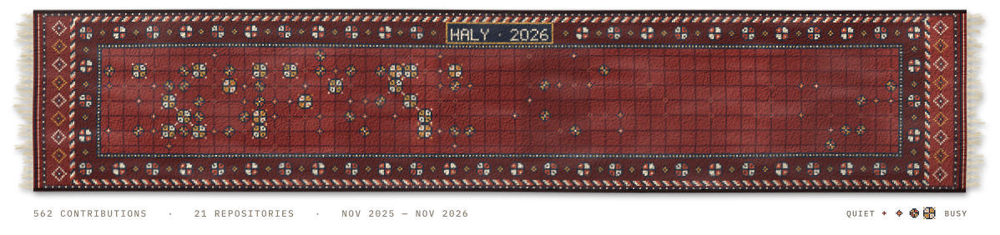
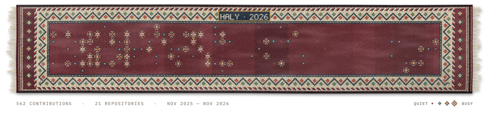
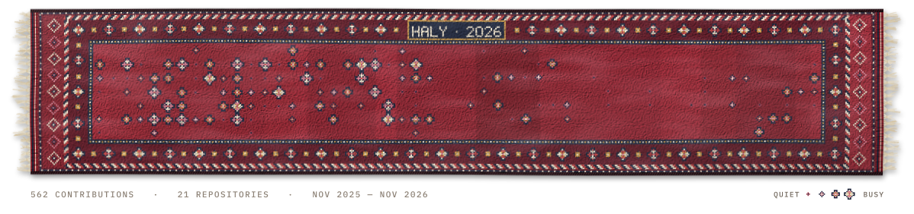
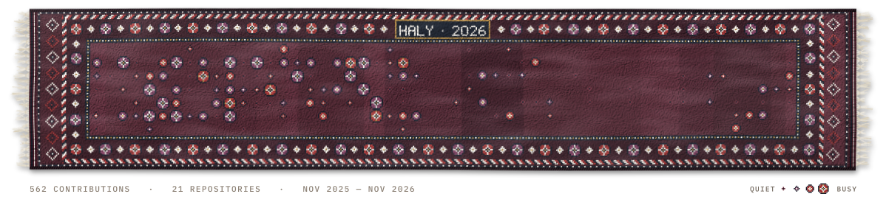
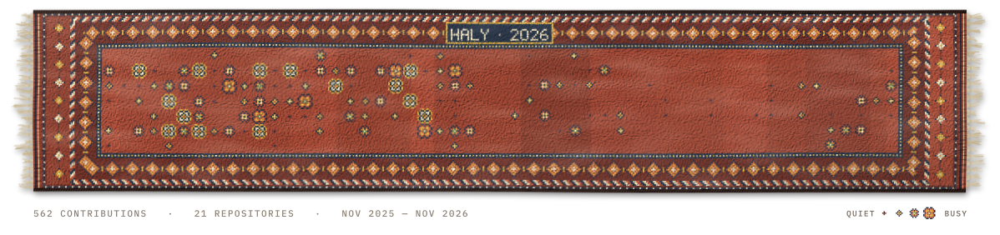

# Haly

**Your GitHub year, woven as a Turkmen carpet.**

*Haly* is Turkmen for carpet. This action reads your contribution calendar and knots it into a Turkmen rug, in the style of any of the five great weaving groups: one gul for every day, larger and paler the busier the day was, framed by the borders, skirts, flat-weave ends and fringe a real rug has. It writes a single SVG you can drop into your profile README.

It is not a heatmap with a rug texture on top. The rug is laid out knot by knot on a real knot lattice, so every motif steps the way a loom forces it to, and the wool, the colour bleeding between knots and the dye-lot banding come from SVG filters rather than from photographs.

## Use it

Add `.github/workflows/haly.yml` to your profile repository (the one named after your username):

```yaml
name: Weave the carpet

on:
  schedule:
    - cron: '17 4 * * *'     # every morning
  workflow_dispatch:

permissions:
  contents: write

jobs:
  weave:
    runs-on: ubuntu-latest
    steps:
      - uses: actions/checkout@v4

      - uses: DovletEmin/haly@v1
        with:
          outputs: assets/carpet.svg

      - name: Commit the new weave
        run: |
          git config user.name  'github-actions[bot]'
          git config user.email '41898282+github-actions[bot]@users.noreply.github.com'
          git add assets/carpet.svg
          git diff --cached --quiet || { git commit -m 'Reweave the carpet' && git push; }
```

Then put it in your `README.md`:

```html

```

Run the workflow once from the Actions tab and the rug appears.

### Inputs

| Input | Default | |
|:--|:--|:--|
| `github_user_name` | the repository owner | Whose year to weave. |
| `github_token` | `github.token` | Sees public contributions. Pass a classic PAT with `read:user` (as a secret) to count private ones too. |
| `outputs` | `dist/carpet.svg` | Where to write the SVG. |
| `animate` | `true` | Replays the weaving, end to end, when the image loads. Set `false` for a still rug. |
| `style` | `tekke` | Which weaving group's guls, borders and dyes: `tekke`, `yomut`, `salor`, `saryk` or `ersari`. See below. |
| `inscription` | *(none)* | Text knotted into a cartouche in the top border, the way weavers worked names and dates into their rugs. `{user}`, `{year}` and `{total}` are filled in. |

The same calendar always produces a byte-identical file, so a daily schedule only commits on days that actually changed something.

## Five weaving groups

Every style keeps the structure of a real main carpet and brings what tells its group apart at a glance: the gul, the border and the dyes.

**Tekke** · `style: tekke`. Madder field, quartered guls linked by a dark lattice, octagons and stars in the border.



**Yomut** · `style: yomut`. Aubergine-brown field, clawed *dyrnak* guls, a running-dog border on ivory, touches of green.



**Salor** · `style: salor`. Crimson field from lac and cochineal, turreted guls quartered on the diagonals, pink silk highlights.



**Saryk** · `style: saryk`. Deep aubergine field, sober guls with hearts of bright white cotton.



**Ersari** · `style: ersari`. Brick-red field, big lobed *gulli* guls with a trefoil in every quarter, strong yellow and green, a chain of lozenges in the border.



At nine knots a side, a day's gul is a sign of the real one rather than a copy, the way the minor guls on a real rug are.

## Inscriptions

```yaml
      - uses: DovletEmin/haly@v1
        with:
          style: yomut
          inscription: '{user} · {year}'
```

The text is knotted, letter by letter, in a 5 × 7 knot alphabet: A to Z, 0 to 9, the Turkmen letters Ä Ç Ň Ö Ş Ü Ý Ž, and `· - . , ' ! & /`. It is upper-cased, anything else is left out with a note in the log, and it is cut at 64 characters.

## How it is woven

From the centre out, it follows the structure of a Turkmen main carpet. These are the Tekke parts; the other groups swap in their own:

| Part | What it is | What it shows |
|:--|:--|:--|
| **Field** | Guls linked by the dark lattice Tekke rugs are known for | One gul per day. Four sizes, with dye levels taken from your own distribution, not fixed thresholds. Neighbouring guls swap colours, as they do on real rugs. |
| **Minor guards** | Three narrow stripes: pearls, a reciprocal barber-pole, pearls on dark | Frame |
| **Main border** | Octagons alternating with stars (or a running band, for Yomut and Ersari) | Spaced the way a weaver counts them, so the corners do not quite resolve. Real ones rarely do. |
| **Elem** | The skirt panels at both ends | A stem strung with hooked diamonds |
| **Kilim** | Flat-woven band where the knotting stops | |
| **Fringe** | The loose warp, gathered and knotted in bundles | Uneven bundles, with the odd stray thread |
| **Selvedge** | Wrapped cord along the long sides | |

And the things that make it read as wool rather than pixels:

- **Pile**: a noise height field, lit from the upper left, stretched slightly along the warp the way pile leans.
- **Bleed**: knot edges are displaced by fine noise, so neighbouring colours fuzz into each other like yarn.
- **Knots**: every knot gets its own small dome of light and shadow.
- **Abrash**: bands of slightly different red running across the warp, where the weaver started a new dye lot.
- **Lie**: the whole rug is bowed a touch and casts a soft shadow, because no hand-knotted rug is truly square.

Dyes are the traditional ones for each group: madder, lac and cochineal reds, indigo, undyed wool and white cotton, saffron and a little green. Every style works on both light and dark GitHub themes.

## Run it locally

```bash
pip install fonttools
python src/haly.py --input examples/sample.json --out carpet.svg          # offline sample
GITHUB_TOKEN=$(gh auth token) python src/haly.py --user <login> --out carpet.svg
python src/haly.py --input examples/sample.json --style salor --inscription 'Aşgabat {year}'
```

`examples/make_sample.py` writes a synthetic calendar if you want to experiment without touching the API.

## Licence

Code under the [MIT licence](LICENSE). The caption is set in IBM Plex Mono, outlined into the SVG, under the [SIL Open Font License](src/fonts/OFL.txt).
